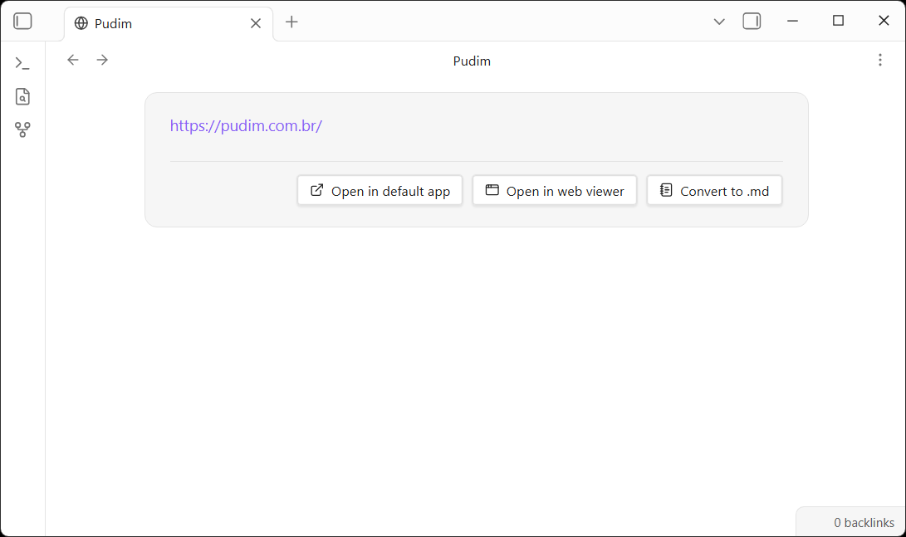

# obsidian-url-file-preview

Preview and edit Windows .url shortcut files in Obsidian, with quick actions to open or convert them.

Windows "Internet Shortcut" (`.url`) files are plain INI-formatted text files
that store a link's URL and optional icon. This plugin registers a dedicated
view for `.url` files so they render as a small card with an inline-editable
URL field and one-click actions — handy for vaults that sync in shortcuts
created on Windows or dragged in from a browser.

## Table of Contents

- [Background](#background)
- [Install](#install)
- [Usage](#usage)
- [Maintainers](#maintainers)
- [Contributing](#contributing)
- [License](#license)

## Background

`.url` files store their data under an `[InternetShortcut]` section, e.g.:

```ini
[InternetShortcut]
URL=https://obsidian.md/
IconFile=https://obsidian.md/favicon.ico
```

This plugin parses that format (preserving unknown keys/sections it doesn't
touch, including `IconFile`), renders the `URL` value as an editable field,
and writes changes back in the same format. It never makes any network
requests of its own — no favicon lookups, no telemetry — everything is local
to your vault except the actions you trigger explicitly (opening a link, or
opening it in the Web Viewer).

One action, **Open in web viewer**, depends on Obsidian's own optional
**Web viewer** core plugin (desktop only, disabled by default). The button is
only shown when that core plugin is enabled under
**Settings → Core plugins**.

## Install

### From the Community Plugins browser

1. In Obsidian, open **Settings → Community plugins → Browse**.
2. Search for `URL File Preview`.
3. Select **Install**, then **Enable**.

### Manual installation

1. Download `main.js`, `manifest.json`, and `styles.css` from the
   [latest release](https://github.com/turingexmachina/obsidian-url-file-preview/releases).
2. Copy them into `<your-vault>/.obsidian/plugins/url-file-preview/`.
3. Reload Obsidian and enable **URL File Preview** under
   **Settings → Community plugins**.

### From source

The Node.js version is pinned via [mise](https://mise.jdx.dev); run
`mise install` first if you have it, otherwise use the Node version in
[.mise.toml](.mise.toml) directly.

```sh
git clone https://github.com/turingexmachina/obsidian-url-file-preview.git
cd obsidian-url-file-preview
npm install
npm run build
```

Then copy `main.js`, `manifest.json`, and `styles.css` into
`<your-vault>/.obsidian/plugins/url-file-preview/`.

## Usage



Open any `.url` file in your vault and it renders as a card with these elements:

- **URL field** — hover it to reveal a pencil icon; click to edit inline,
  then **Save** (or press <kbd>Enter</kbd>) or **Cancel** (<kbd>Esc</kbd>).
- **Open in default app** — opens the `.url` file itself with your OS's
  default handler, the same as **Open in default app** from the file
  explorer's right-click menu. Desktop only.
- **Open in web viewer** — opens the link in Obsidian's core Web Viewer.
  Only shown when that core plugin is enabled.
- **Convert to .md** — replaces the `.url` file with a Markdown note
  containing the link in its frontmatter (`source: <url>`).

Double-clicking a `.url` file in the file explorer skips the preview card and
opens the link directly, for quick access.

## Maintainers

- [@turingexmachina](https://github.com/turingexmachina)

## Contributing

Issues and pull requests are welcome at the
[GitHub repository](https://github.com/turingexmachina/obsidian-url-file-preview).
Please open an issue first to discuss substantial changes, and make sure
`npm run build` (typecheck + production bundle) passes before submitting a PR.

## License

[MIT](LICENSE) © turingexmachina
